<h1 align="center">GraphRAG</h1>

<p align="center">
  <em>GraphRAG built from scratch: entity and relation extraction, knowledge-graph construction, and traversal-based multi-hop retrieval.</em>
</p>

<p align="center">
  <a href="https://github.com/adeoluo/graphrag/actions/workflows/ci.yml"></a>
  
  
  
  
  
</p>

---

## Motivation

Vector RAG retrieves passages by similarity, which fails when the answer is spread across
documents: "What country is the Eiffel Tower in?" needs the fact that the Eiffel Tower is
in Paris *and* that Paris is the capital of France - two facts no single passage states.
GraphRAG instead extracts entities and relations into a **knowledge graph** and answers by
**traversing explicit edges**, so multi-hop questions are resolved by following the graph.
This project builds that end to end **from first principles**, with **zero runtime
dependencies** and a deterministic, offline test suite.

## Architecture

<p align="center">
  
</p>

Documents are parsed by **entity and relation extraction** into triples that populate a
**knowledge graph**. A question is answered by **linking** its mentions to graph entities,
**traversing** outward (breadth-first) to gather a connected subgraph, and reading the
answer off a **relation path**. See the [ADRs](docs/adr/) for key choices.

## Results

> Reproduce with `python -m graphrag evaluate`. Answer accuracy over 6 labeled questions
> (2 of them genuinely multi-hop).

| Method | overall | multi-hop | single-hop |
|---|---:|---:|---:|
| flat keyword baseline | 0.67 | **0.00** | 1.00 |
| **graph traversal** | **1.00** | **1.00** | 1.00 |

This is the whole thesis: the flat baseline scores **zero** on multi-hop questions because
no single passage contains the answer, while graph traversal reaches it by chaining
relation edges - a **+1.00** gain, with no regression on single-hop questions.

## Demonstration

```text
$ python -m graphrag ask "What country is the Eiffel Tower in"
Linked entities: Eiffel Tower
Relation path:
  (Eiffel Tower) -[located_in]-> (Paris)
  (Paris) -[capital_of]-> (France)
Answer: France  (confidence 0.80)
```

## Quickstart

```bash
git clone https://github.com/adeoluo/graphrag.git && cd graphrag
make setup                    # install dev tooling + pre-commit hooks
make all                      # lint + type-check + test

python -m graphrag graph                               # print the knowledge graph
python -m graphrag evaluate                            # graph vs flat retrieval
python -m graphrag ask "What country is the Colosseum in"
```

Use the library directly:

```python
from graphrag import build_graph, GraphRetriever

graph = build_graph(
    [("d0", "The Eiffel Tower is located in Paris."), ("d1", "Paris is the capital of France.")]
)
answer = GraphRetriever(graph).retrieve("What country is the Eiffel Tower in")
print(answer.answer, [r.as_triple() for r in answer.path])
```

## Components

- **Extraction** - rule-based entity extraction (capitalized noun phrases) and relation
  extraction (`capital_of`, `located_in`, `part_of`, `is_a`, `borders`, `flows_through`),
  each relation recording its source document for provenance.
- **Knowledge graph** - a directed, labeled multigraph with neighbor lookup, breadth-first
  multi-hop traversal, and subgraph extraction.
- **Entity linking** - matches a question's mentions to graph entities (exact, then
  containment).
- **Traversal retrieval** - follows a target relation, or chains location and capital edges
  for compound "what country" questions, returning a cited path and confidence.
- **Evaluation** - `evaluate` scores answer accuracy, split by single- vs multi-hop.

## Design decisions

- **Rule-based extraction.** The project's contribution is the graph construction and
  traversal, so extraction is deterministic and inspectable; a model-backed extractor drops
  in behind `extract_relations`. ([ADR-0002](docs/adr/0002-rule-based-extraction.md))
- **Traversal, not similarity.** Answers come from following explicit edges, which is what
  lets multi-hop questions resolve. ([ADR-0003](docs/adr/0003-traversal-retrieval.md))
- **Zero runtime dependencies.** The graph, extractor, and retriever are pure Python.

## Performance

A deterministic micro-benchmark (`uv run python benchmarks/benchmark.py`) builds a graph of
roughly fifteen hundred entities and a thousand relations from a thousand synthetic
sentences and runs five hundred multi-hop traversal queries. On a laptop the graph builds in
a few milliseconds and traversal sustains thousands of queries per second, because each
answer follows a short path through an adjacency index rather than scanning passages.

## Responsible AI

- **Model card:** [docs/MODEL_CARD.md](docs/MODEL_CARD.md)
- **Data card:** [docs/DATA_CARD.md](docs/DATA_CARD.md)
- **Threat model:** [docs/THREAT_MODEL.md](docs/THREAT_MODEL.md)

## Limitations

- Extraction is rule-based; messy prose needs a model-backed extractor (a deliberate
  boundary to stay from-scratch and dependency-free).
- The relation vocabulary and compound-question handling are small and illustrative.
- The bundled corpus is a demonstration, not a competitive multi-hop benchmark.

## Roadmap

- [ ] Model-backed triple extraction behind the existing interface
- [ ] Weighted edges and community detection for graph summarization
- [ ] A larger multi-hop benchmark with graded answers

## License

[MIT](LICENSE). Part of a 28-project artificial intelligence engineering portfolio by
[adeoluo](https://github.com/adeoluo).
