<h1 align="center">GraphRAG</h1>

<p align="center">
  <em>GraphRAG built from scratch: entity and relation extraction, knowledge-graph construction, and traversal-based multi-hop retrieval.</em>
</p>

<p align="center">
  <a href="https://github.com/adeoluo/graphrag/actions/workflows/ci.yml"></a>
  <a href="https://github.com/adeoluo/graphrag/releases"></a>
  
  <a href="LICENSE"></a>
</p>

---

## Motivation

Vector RAG retrieves passages by similarity, which fails when the answer is spread across
documents: "What country is the Eiffel Tower in?" needs the fact that the Eiffel Tower is
in Paris *and* that Paris is the capital of France, two facts no single passage states.
GraphRAG instead extracts entities and relations into a **knowledge graph** and answers by
**traversing explicit edges**, so multi-hop questions are resolved by following the graph.
This project builds that end to end **from scratch**, with a deterministic, offline test suite.

## Architecture

<p align="center">
  
</p>

<sub>Legend: amber = entry points and external systems, indigo = core logic, green = data and state, blue = validation and control, grey = observability and outputs.</sub>

Documents are parsed by **entity and relation extraction** into triples that populate a
**knowledge graph**. A question, from the CLI or a validated `/ask` request, is answered by
**linking** its mentions to graph entities, **traversing** outward (breadth-first, up to three
hops) to gather a connected subgraph, and reading the answer off a **relation path** that
doubles as the citation. The evaluation scores graph answers and a flat keyword baseline on
the same single- and multi-hop questions, and every route records latency and errors for
`/metrics`. See the [ADRs](docs/adr/) for key choices.

### Components

- **Extraction**: rule-based entity extraction (capitalized noun phrases) and relation
  extraction (`capital_of`, `located_in`, `part_of`, `is_a`, `borders`, `flows_through`),
  each relation recording its source document for provenance.
- **Knowledge graph**: a directed, labeled multigraph with neighbor lookup, breadth-first
  multi-hop traversal, and subgraph extraction.
- **Entity linking**: matches a question's mentions to graph entities (exact, then
  containment).
- **Traversal retrieval**: follows a target relation, or chains location and capital edges
  for compound "what country" questions, returning a cited path and confidence.
- **Evaluation**: `evaluate` scores answer accuracy, split by single- vs multi-hop.

## Results

> Reproduce with `python -m graphrag evaluate`. Answer accuracy over 6 labeled questions
> (2 of them genuinely multi-hop).

| Method | overall | multi-hop | single-hop |
|---|---:|---:|---:|
| flat keyword baseline | 0.67 | **0.00** | 1.00 |
| **graph traversal** | **1.00** | **1.00** | 1.00 |

This is the whole thesis: the flat baseline scores **zero** on multi-hop questions because
no single passage contains the answer, while graph traversal reaches it by chaining
relation edges, a **+1.00** gain, with no regression on single-hop questions.

### Scale

`benchmarks/scale.py` builds knowledge graphs from progressively larger synthetic
corpora of relation chains and answers up to 200 genuinely multi-hop questions
against each, reporting graph size, wall-clock time, traversal throughput, peak
memory (stdlib `tracemalloc`), and multi-hop answer accuracy. Measured on this
machine (`uv run python benchmarks/scale.py`):

| Chains | Entities | Seconds | Queries/sec | Peak MiB | Accuracy |
|---:|---:|---:|---:|---:|---:|
| 250 | 751 | 0.16 | 1,371 | 0.4 | 1.00 |
| 500 | 1,501 | 0.33 | 656 | 0.8 | 1.00 |
| 1,000 | 3,001 | 0.66 | 322 | 1.4 | 1.00 |
| 2,000 | 6,001 | 1.41 | 151 | 3.1 | 1.00 |

Traversal stays exact (accuracy 1.00) as the graph grows, but throughput falls
because the from-scratch retriever rescans relation edges per query to locate the
terminal country. These numbers are from synthetic data on a Python
implementation; they are **not** a comparison against production graph databases
or vector stores, which would be far faster and are the right tool at real scale.

### Performance and reliability

A deterministic micro-benchmark (`uv run python benchmarks/benchmark.py`) builds a graph of
roughly fifteen hundred entities and a thousand relations from a thousand synthetic
sentences and runs five hundred multi-hop traversal queries. On a laptop the graph builds in
a few milliseconds and traversal sustains thousands of queries per second, because each
answer follows a short path through an adjacency index rather than scanning passages.

A production-style stress benchmark (`uv run python benchmarks/stress.py`) drives the full
service handler under concurrent load and reports throughput with p50, p95, and p99 latency.
It surfaces a real constraint: the CPU-bound Python traversal is limited by the global interpreter
lock, so throughput is flat across threads and the tail grows with concurrency; the service
is scaled with processes. The scaling path and tradeoffs are in [docs/SCALING.md](docs/SCALING.md),
and a full request walk-through is in the [case study](docs/CASE_STUDY.md).

## Quickstart

```bash
git clone https://github.com/adeoluo/graphrag.git && cd graphrag
make setup                    # install dev tooling + pre-commit hooks
make all                      # lint + type-check + test

python -m graphrag graph                               # print the knowledge graph
python -m graphrag evaluate                            # graph vs flat retrieval
python -m graphrag ask "What country is the Colosseum in"
```

Use the library directly:

```python
from graphrag import build_graph, GraphRetriever

graph = build_graph(
    [("d0", "The Eiffel Tower is located in Paris."), ("d1", "Paris is the capital of France.")]
)
answer = GraphRetriever(graph).retrieve("What country is the Eiffel Tower in")
print(answer.answer, [r.as_triple() for r in answer.path])
```

## Usage

### Command line

```text
$ python -m graphrag ask "What country is the Eiffel Tower in"
Linked entities: Eiffel Tower
Relation path:
  (Eiffel Tower) -[located_in]-> (Paris)
  (Paris) -[capital_of]-> (France)
Answer: France  (confidence 0.80)
```

### HTTP service

A standard-library HTTP service exposes graph retrieval as a production-style JSON API:

```bash
python -m graphrag serve --port 8000

curl localhost:8000/health
curl -s -X POST localhost:8000/ask -d '{"query": "What country is the Eiffel Tower in"}'
```

`GET /health` reports entity and relation counts; `POST /ask` returns the answer, the
relation path used as a citation, the linked entities, and a confidence. See the
[operations guide](docs/OPERATIONS.md) for the service contract and operational constraints. The service also exposes `GET /ready` (readiness) and `GET /metrics`
(per-route request, error, and latency metrics in Prometheus text format).

## Design decisions

- **Rule-based extraction.** The project's contribution is the graph construction and
  traversal, so extraction is deterministic and inspectable; a model-backed extractor drops
  in behind `extract_relations`. ([ADR-0002](docs/adr/0002-rule-based-extraction.md))
- **Traversal, not similarity.** Answers come from following explicit edges, which is what
  lets multi-hop questions resolve. ([ADR-0003](docs/adr/0003-traversal-retrieval.md))
- **From-scratch core.** The graph, extractor, and retriever are implemented in this package,
  so every hop of a retrieval is inspectable.

## Testing

```bash
make test        # uv run pytest
make coverage    # pytest with an 80% coverage gate, as in CI
make lint type   # ruff format check, ruff lint, mypy
```

- `tests/test_core.py`: the knowledge graph (relation insertion, neighbor lookup, breadth-first traversal and hop limits, subgraphs) and entity and relation extraction.
- `tests/test_retrieval.py`: entity linking and traversal retrieval for single-hop, location, multi-hop, and unknown-entity questions.
- `tests/test_eval_cli.py`: the labeled question set, the check that graph traversal beats flat retrieval on multi-hop questions, and the command-line interface.
- `tests/test_service.py`: the HTTP handler layer, including health, readiness, metrics, `/ask`, input validation, and unknown routes.

CI runs ruff format, ruff lint, mypy, and pytest with the coverage gate on Python 3.11 and 3.12, then builds the package and the Docker image.

## Responsible AI

- **Model card:** [docs/MODEL_CARD.md](docs/MODEL_CARD.md)
- **Data card:** [docs/DATA_CARD.md](docs/DATA_CARD.md)
- **Threat model:** [docs/THREAT_MODEL.md](docs/THREAT_MODEL.md)

## Limitations

- Extraction is rule-based; messy prose needs a model-backed extractor (a deliberate
  boundary to keep the pipeline from scratch and inspectable).
- The relation vocabulary and compound-question handling are small and illustrative.
- The bundled corpus is a demonstration, not a competitive multi-hop benchmark.

## Roadmap

- [ ] Model-backed triple extraction behind the existing interface
- [ ] Weighted edges and community detection for graph summarization
- [ ] A larger multi-hop benchmark with graded answers

## License

Released under the [MIT License](LICENSE).
